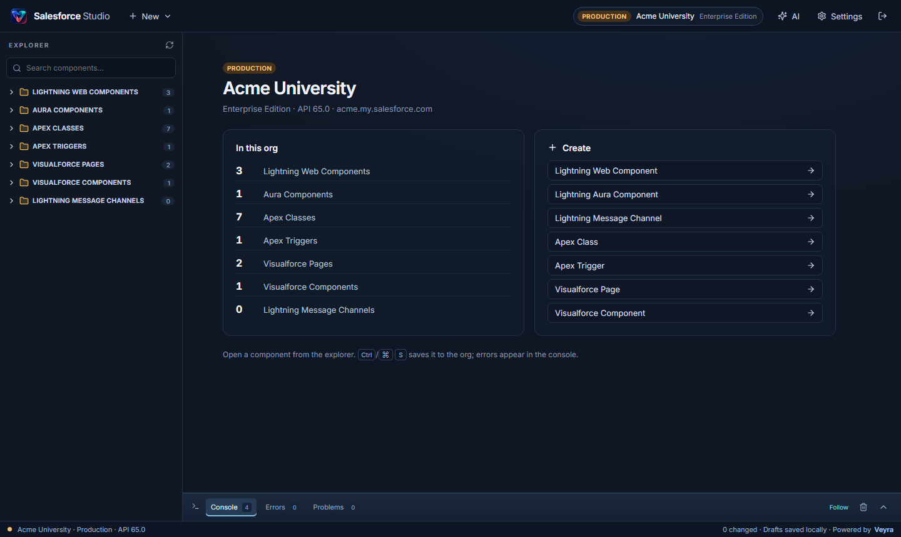
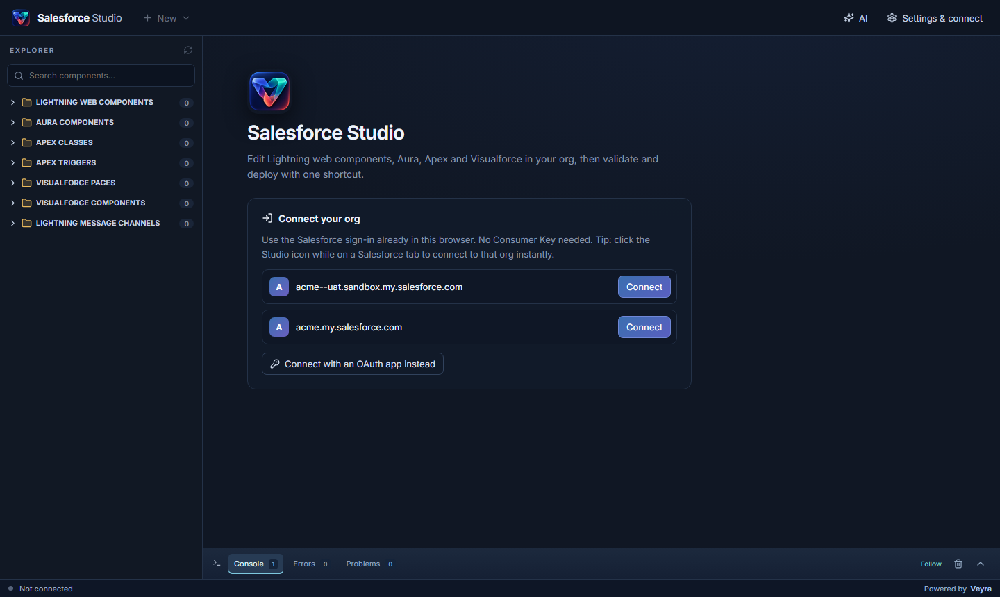
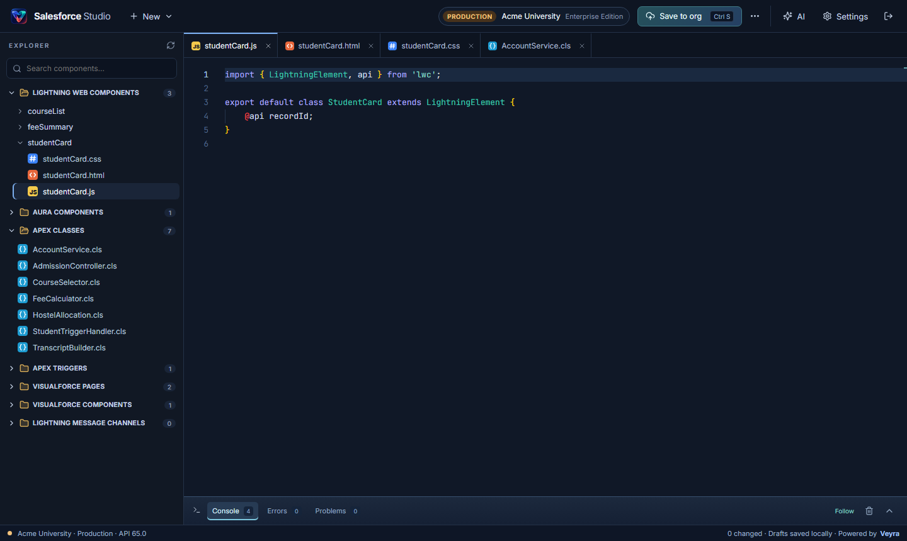
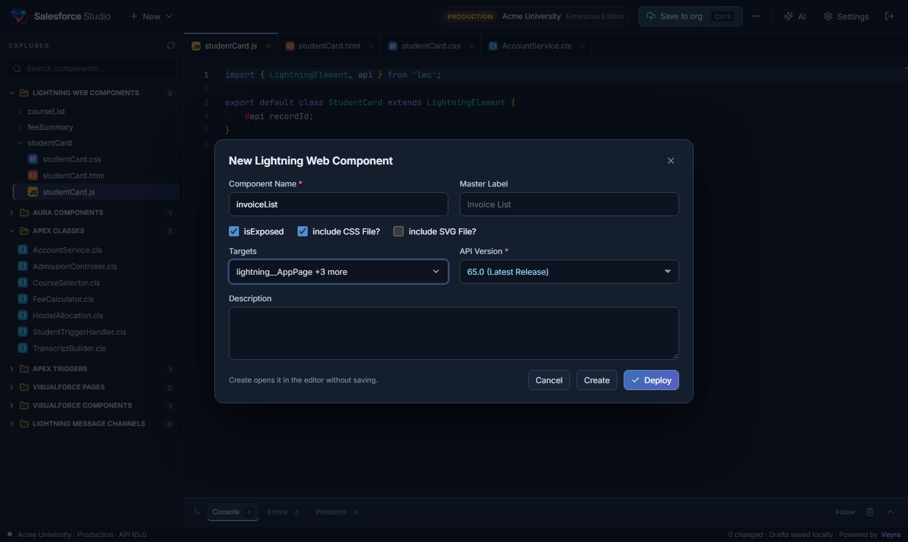

# Salesforce Studio

### Your org's code, open in seconds.

Edit Lightning web components, Aura, Apex and Visualforce right in your browser. 
One click from any Salesforce tab. <kbd>Ctrl</kbd> + <kbd>S</kbd> saves straight to your org.

**[Download](https://github.com/fcopensource/salesforce-studio-releases/releases/latest)** ·
**[Website](https://veyraeditor.com/salesforce-studio)** ·
**[Connect your org](docs/CONNECT-YOUR-ORG.md)** ·
**[Report an issue](https://github.com/fcopensource/salesforce-studio-releases/issues)**

 

 

## ✨ Highlights

<table>
<tr>
<td width="33%" valign="top">

### ⚡ Opens in seconds
Every Lightning web component, Aura bundle, Apex class and Visualforce page in your org loads at once. No waiting on a queued retrieval.

</td>
<td width="33%" valign="top">

### 🖱️ One-click connect
Click the Studio icon on any Salesforce tab and it opens in its own app window, connected to that org. No OAuth app, no Consumer Key.

</td>
<td width="33%" valign="top">

### 💾 Ctrl+S saves
Straight to the org, like Lightning Studio: no validation step, no waiting. Errors appear in red in the console.

</td>
</tr>
<tr>
<td valign="top">

### 🗂️ A familiar explorer
Lightning Web Components, Aura, Apex, triggers, Visualforce and message channels, in Lightning Studio's order with counts.

</td>
<td valign="top">

### ➕ Create anything
Lightning Studio-style forms for every type: an LWC with master label, isExposed, CSS, SVG and searchable targets.

</td>
<td valign="top">

### 🧠 A real code editor
The editor behind VS Code, with LWC typings, Salesforce snippets, Apex keywords, formatting, tabs and file-type icons.

</td>
</tr>
</table>

## 🚀 Install

> Works in **Google Chrome** and **Microsoft Edge**. No Salesforce CLI, backend or account needed.

1. Download **`salesforce-studio-<version>.zip`** from the [latest release](https://github.com/fcopensource/salesforce-studio-releases/releases/latest) and unzip it.
2. Open `chrome://extensions` or `edge://extensions` and turn on **Developer mode**.
3. Click **Load unpacked** and choose the unzipped folder.
4. Pin **Salesforce Studio** from the Extensions (🧩) menu.

**Updating:** unzip the new release over the same folder and click **Reload** on the extension. Your drafts are kept.

## 🔌 Connect in one click

Sign in to Salesforce as usual, then **click the Salesforce Studio icon while on a Salesforce tab**: Lightning, Setup, Classic or Visualforce, production or sandbox. Studio opens in its own full-size window, like a desktop app, connected to that org. Click the icon again to bring it to the front; each org gets its own window.

Not on a Salesforce tab? The home screen lists every org you are signed in to, each with a **Connect** button.

Studio never stores your Salesforce password or session, and signing out of Salesforce disconnects it. Orgs that block browser sign-in for the API can connect with their own OAuth app instead. See [Connect your org](docs/CONNECT-YOUR-ORG.md).

## 🛠️ Everything it can do

### Browse

| Folder | Metadata type |
| :-- | :-- |
| ⚡ Lightning Web Components | `LightningComponentBundle` |
| 🧩 Aura Components | `AuraDefinitionBundle` |
| 📘 Apex Classes | `ApexClass` |
| 🔁 Apex Triggers | `ApexTrigger` |
| 📄 Visualforce Pages | `ApexPage` |
| 🧱 Visualforce Components | `ApexComponent` |
| 📡 Lightning Message Channels | `LightningMessageChannel` |

Search across every component, open files in tabs, and tell HTML, CSS, JavaScript and XML apart at a glance. Only your org's own code is shown; managed-package components are skipped.

### Create

Pick a type from **New** and fill in a short form. Studio writes the files and their metadata for you. **Deploy** saves the new component to the org in one step; **Create** opens it in the editor first.

| Type | The form asks for |
| :-- | :-- |
| Lightning Web Component | Name, master label, isExposed, CSS file, SVG file, **targets** (searchable), API version, description |
| Apex Trigger | Name, **object**, **events** (before/after insert, update, delete, undelete), API version |
| Aura, Visualforce, Message Channel | Name, label, API version, description |
| Apex Class | Name, API version |

Every form offers the API versions your org supports, newest first, and checks the name before anything is sent.

### Save

<kbd>Ctrl</kbd> + <kbd>S</kbd> (<kbd>⌘</kbd> + <kbd>S</kbd> on a Mac) saves the open component **straight to the org**, in sandboxes and production alike.

| You save | Speed |
| :-- | :-- |
| LWC, Aura, Visualforce | ⚡ about a second |
| Apex class or trigger | Seconds in a sandbox. In production, Salesforce runs your Apex tests for any Apex change |
| A new component | Seconds |

If Salesforce rejects a file, for example with an LWC compile error, the console shows the message in red and your edit stays in the editor.

### Review (optional)

**Review changes** in the **•••** menu shows a diff of everything you edited. Validate it first, choose the Apex test level, and deploy several components together. It warns you if someone changed a component in the org since you opened it, and in production asks you to type the org name before deploying. A running deployment can be resumed at any time without resubmitting.

### And more

- **Component menu.** Every component has a ••• menu: **Download as ZIP** (ready to deploy anywhere, with its metadata, a package.xml and your unsaved edits), **Copy name** and **Delete from org** (asks first; in production you type the name).
- **Quick Open.** <kbd>Ctrl</kbd> + <kbd>P</kbd> jumps to any file by typing part of its name.
- **Make it yours.** Drag the explorer edge to resize it. In **Settings**, set the font size, word wrap and minimap.
- **Drafts that survive.** Every edit is kept in your browser, per org, so closing a tab never loses work.
- **Format document.** <kbd>Shift</kbd> + <kbd>Alt</kbd> + <kbd>F</kbd> formats JavaScript, HTML, CSS, JSON and XML; Apex gets careful re-indentation.
- **Console and Problems.** Timestamped activity, red errors, and editor problems that jump to the line.
- **AI assistant (optional).** Click **AI** to ask about the open file through an AI service you configure in **Settings**. Your Salesforce session is never sent to it.

## ⌨️ Keyboard shortcuts

| Shortcut | Action |
| :-- | :-- |
| <kbd>Ctrl</kbd> + <kbd>S</kbd> | Save the open component to the org |
| <kbd>Shift</kbd> + <kbd>Alt</kbd> + <kbd>F</kbd> | Format document |
| <kbd>Ctrl</kbd> + <kbd>P</kbd> | Go to any file |
| <kbd>Ctrl</kbd> + <kbd>Space</kbd> | Suggestions |
| <kbd>Ctrl</kbd> + <kbd>Z</kbd> | Undo, including a Discard or a reload |
| <kbd>Esc</kbd> | Close a menu, the targets list or the New dialog |

On a Mac, use <kbd>⌘</kbd> for <kbd>Ctrl</kbd>.

## 🔒 Privacy and permissions

Studio runs in your browser and talks only to your Salesforce org, and to an AI service if you set one. It has **no backend, no analytics and no telemetry**, and we never see your code, data or credentials.

| Permission | Why it is needed |
| :-- | :-- |
| Cookies | Use the Salesforce sign-in you already have in this browser |
| Storage | Remember which org you chose and your settings |
| Identity | Optional sign-in with your own Salesforce OAuth app |
| Salesforce sites | Recognise the org of a Salesforce tab and work with it |
| Optional site access | Asked for only when you set an AI service, for that one address |

## 🧭 Limits

- One org at a time; no cross-org promotion or Git integration yet.
- Lightning Types are not shown yet.
- Apex compile errors come from your org when you save.
- An Apex change in production runs all local tests, as Salesforce requires.
- Your user needs API access and permission to modify metadata. See [Connect your org](docs/CONNECT-YOUR-ORG.md#3-check-your-users-access).

## 📜 License

Salesforce Studio is a **commercial product of Veyra / Flightcoders, free to use**. 
Copyright © 2026 Veyra / Flightcoders. All rights reserved.

You may install and use it in your own browsers, for personal or business work. You may not copy, modify, reverse engineer, redistribute or resell it. The full terms are in the **[License Agreement](LICENSE)**.

It includes open-source components (React, Monaco Editor, Prettier, fflate, Lucide, Inter and JetBrains Mono) under their own licenses. The full notices ship inside the extension in `licenses/THIRD-PARTY-NOTICES.txt`.

**Trademarks.** Salesforce Studio is an independent product and is not affiliated with, sponsored or endorsed by Salesforce, Inc. Salesforce, Lightning, Apex and Visualforce are trademarks of Salesforce, Inc., used here only to describe what Studio works with.

 

Made with 💜 by the **[Veyra](https://veyraeditor.com)** team

Also from Veyra: <a href="https://veyraeditor.com">Veyra Studio</a> · <a href="https://veyraeditor.com/live-server">Veyra Live Server</a> · <a href="https://veyraeditor.com/port-manager">Veyra Port Manager</a>

